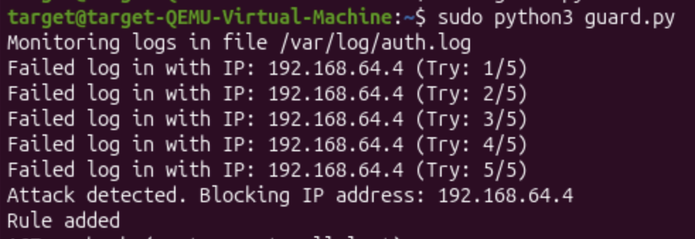
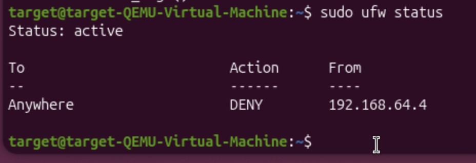

# Automated SSH Brute-Force Detection and Prevention System

## Executive Summary

This project demonstrates an automated log analysis and threat mitigation pipeline implemented on a Linux platform. The system continuously monitors authentication logs for SSH brute-force attack patterns, extracts malicious source IP addresses using regular expressions, and dynamically applies firewall rules via Uncomplicated Firewall (UFW) to block attacker traffic before unauthorized access can occur.

---

## Architecture and Lab Topology

The testing environment was built using isolated virtual machines within a host-only virtual network:

* **Target System (Defender):** Ubuntu Linux Server hosting an OpenSSH server (`sshd`), system authentication log files (`/var/log/auth.log`), and a custom Python intrusion prevention script (`guard.py`).
* **Attacker System (Threat Actor):** Ubuntu workstation running THC Hydra to conduct dictionary attacks against the SSH service.
* **Network Integration:** Virtual interface operating within an isolated private IP subnet (`192.168.64.0/24`).

---

## Technical Stack

* **Programming Language:** Python 3 (standard library modules: `re`, `subprocess`, `time`, `os`).
* **Security & Network Tools:** UFW (Uncomplicated Firewall), OpenSSH Server, THC Hydra v9.6.
* **Operating System:** Ubuntu Linux / Debian-based OS.

---

## Component Details & Implementation

### 1. Threat Detection Mechanism (`guard.py`)

The detection script continuously streams entries from `/var/log/auth.log` by moving the file pointer to the end of the file (`SEEK_END`), replicating real-time log ingestion behavior.

* **Pattern Matching:** Regular expressions scan log lines for authentication failure indicators (`Failed password`, `preauth`).
* **IP Extraction:** Source IP addresses are isolated using the IPv4 regular expression pattern `(\d{1,3}\.\d{1,3}\.\d{1,3}\.\d{1,3})`.
* **State Management & Thresholding:** Failed login attempts per unique IP address are tracked in a hash map. Upon reaching the configured threshold (`MAX_ATTEMPTS = 5`), an automated mitigation event is triggered.

```python
import time
import subprocess
import re
import os

LOG_FILE = "/var/log/auth.log"
MAX_ATTEMPTS = 5
failed_attempts = {}

def block_ip(ip_address):
    print(f"Attack detected. Blocking IP address: {ip_address}")
    subprocess.run(f"sudo ufw deny from {ip_address}", shell=True)

def monitor_logs():
    print(f"Monitoring logs in file {LOG_FILE}")
    
    f = open(LOG_FILE, "r")
    f.seek(0, os.SEEK_END)
    
    while True:
        line = f.readline()
        if not line:
            time.sleep(0.5)
            continue
        
        if "Failed password" in line or "preauth" in line:
            match = re.search(r'(\d{1,3}\.\d{1,3}\.\d{1,3}\.\d{1,3})', line)
            if match:
                ip = match.group(1)
                
                if ip == "127.0.0.1":
                    continue
                    
                failed_attempts[ip] = failed_attempts.get(ip, 0) + 1
                print(f"Failed log in with IP: {ip} (Try: {failed_attempts[ip]}/{MAX_ATTEMPTS})")
                
                if failed_attempts[ip] >= MAX_ATTEMPTS:
                    block_ip(ip)
                    failed_attempts[ip] = 0

if __name__ == "__main__":
    monitor_logs()

```
#### Status of attempts


#### Consequence


---

## Validation and Proof of Concept

### Attack Execution

A dictionary attack was initiated from the threat host using THC Hydra targeting the SSH daemon on the target host:

```bash
hydra -I -l target -P passwords.txt ssh://192.168.64.3

```

### Detection and Mitigation Flow

1. **Inbound Traffic Analysis:** THC Hydra submitted consecutive password attempts.
2. **Log Registration:** The target system recorded failed authentication attempts in `/var/log/auth.log`.
3. **Automated Intervention:** Upon the 5th failed attempt, `guard.py` detected the threshold violation and executed `sudo ufw deny from 192.168.64.4`.
4. **Attacker Disruption:** Subsequent packets from the attacker host were dropped at the network layer. THC Hydra was unable to establish further TCP sessions, resulting in connection timeouts and preventing the credential discovery process.

---

## Key Takeaways

* Demonstrates practical knowledge of Linux system logging, pattern recognition, and security auditing.
* Implements the core operational principles of a Security Information and Event Management (SIEM) system combined with automated Incident Response (IR).
* Proves the effectiveness of network-level access control in neutralizing brute-force credential stuffing before successful authorization.